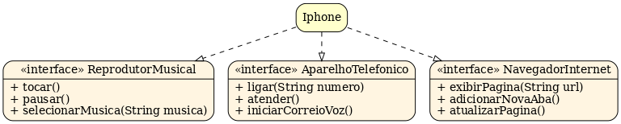

# Diagrama UML — funcionalidades de um iPhone

Estudo de modelagem orientada a objetos que representa um dispositivo por três interfaces: reprodutor musical, aparelho telefônico e navegador de internet.

## Diagrama

O arquivo está disponível em [diagrama_iphone_interfaces.png](diagrama_iphone_interfaces.png).

## Modelo documentado

| Responsabilidade | Operações |
| --- | --- |
| Reprodutor musical | `tocar()`, `pausar()`, `selecionarMusica(String musica)` |
| Aparelho telefônico | `ligar(String numero)`, `atender()`, `iniciarCorreioVoz()` |
| Navegador de internet | `exibirPagina(String url)`, `adicionarNovaAba()`, `atualizarPagina()` |

A proposta é que a classe `Iphone` implemente as três interfaces, reunindo as responsabilidades do dispositivo por meio de contratos distintos.

## Objetivo do estudo

- Identificar responsabilidades de uma classe.
- Representar contratos com interfaces.
- Relacionar modelagem UML e conceitos de orientação a objetos em Java.

## Como consultar

Abra a imagem pelo GitHub ou por um visualizador de imagens local. O repositório contém a documentação e o diagrama em PNG; não há código Java executável, dependências ou testes.

## Referência do exercício

Proposta do [desafio de POO da Trilha Java Básico da DIO](https://github.com/digitalinnovationone/trilha-java-basico/blob/main/desafios/poo/README.md), de [Gleyson Sampaio](https://github.com/glysns).
